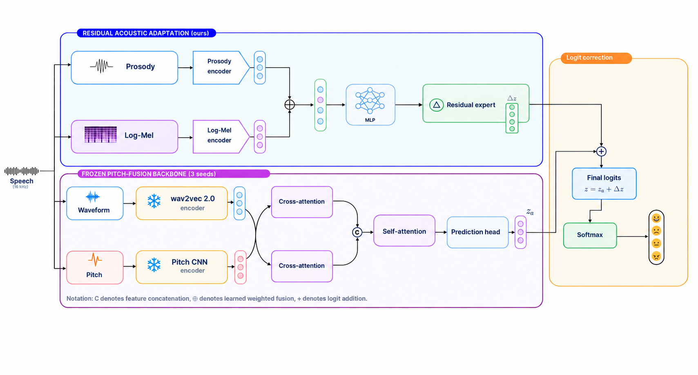

# Residual Acoustic Adaptation of Pitch-Fusion

Reference implementation and reproducibility artifacts for Vietnamese speech emotion recognition
on ViSEC under a controlled speaker-overlap protocol.



## Scope

The repository contains the reproduced Pitch-Fusion backbone, the residual acoustic adapter,
controlled split manifests, experiment configurations, integrity checks, and paper result tables.
ViSEC audio, cached features, and model checkpoints are not redistributed.

The adapter combines frame-level Prosody and Log-Mel representations with disagreement statistics
from three Pitch-Fusion anchors. The final model uses direct logit correction:

```text
final_logits = anchor_logits + residual_logits
```

No correction gate is used in the reported full configuration.

## Protocol statement

**This experiment uses a speaker-overlapping controlled stratified split. It is not a
speaker-independent evaluation.** Utterances and audio hashes are disjoint across Train,
Validation, and Test; speaker identities may overlap by design.

## Main test result

| Model | WA (%) | UA (%) | Macro-F1 (%) |
|---|---:|---:|---:|
| Pitch-Fusion ensemble | 72.63 | 70.84 | 71.26 |
| Residual acoustic adaptation | 73.16 | 72.48 | 72.43 |

See [docs/RESULTS.md](docs/RESULTS.md) and the machine-readable files in `results/`.

## Repository layout

```text
configs/                 Locked experiment configurations
docs/                    Protocol and reproducibility documentation
figures/                 Architecture and split-distribution figures
results/                 Machine-readable validation and test tables
splits/                  Exact controlled split membership and speaker audit
src/rapf/                Data, model, training, and evaluation code
tests/                   Integrity and architecture tests
```

## Installation

Python 3.11 and a CUDA-capable PyTorch environment are recommended.

```bash
python -m venv .venv
python -m pip install --upgrade pip
python -m pip install -r requirements.txt
python -m pip install -e .
```

## Verify the release

```bash
pytest -q
```

The tests verify split sizes, utterance/audio-hash isolation, Speaker 0 allocation, the residual
adapter parameter counts, and direct residual logit addition.

## Recreate the controlled split

Place the eligible ViSEC manifest at `data/clean_manifest.csv`, then run:

```bash
python -m rapf.data.controlled_split
```

Allocation uses metadata only; model predictions and performance metrics are not accepted as
split inputs.

## Train Pitch-Fusion

Prepare the ViSEC audio Parquet file, cached feature table, and split manifests described in
[docs/REPRODUCIBILITY.md](docs/REPRODUCIBILITY.md), then run each seed:

```bash
python -m rapf.training.train_pitch_fusion --seed-override 42 --skip-test
python -m rapf.training.train_pitch_fusion --seed-override 2025 --skip-test
python -m rapf.training.train_pitch_fusion --seed-override 3407 --skip-test
```

After selecting checkpoints by validation UA, construct the three-seed anchor and disagreement
features with `rapf.training.build_ensemble_anchor` and
`rapf.training.build_disagreement_features`.

## Train the residual adapter

For the full no-gate configuration used in the paper:

```bash
python -m rapf.training.train_residual_adapter \
  --anchor artifacts/anchors/disagreement_aware_train_val_anchor.parquet \
  --anchor-aux-size 9 \
  --force-correction-alpha-one \
  --minimum-required-ua-gain 0.003 \
  --seed 2025 \
  --output-dir artifacts/residual_adapter/seed2025
```

Repeat with seeds 42 and 3407. Checkpoint selection is based on validation UA only.

## Upstream implementation

The Pitch-Fusion architecture follows
[Lamnu1902/Pitch-fusion](https://github.com/Lamnu1902/Pitch-fusion) at commit
`2e8e05f940fce265f2c4c1bb28d7475d622639f869`, with the preprocessing and controlled-split
differences recorded in `configs/pitch_fusion.json`.
